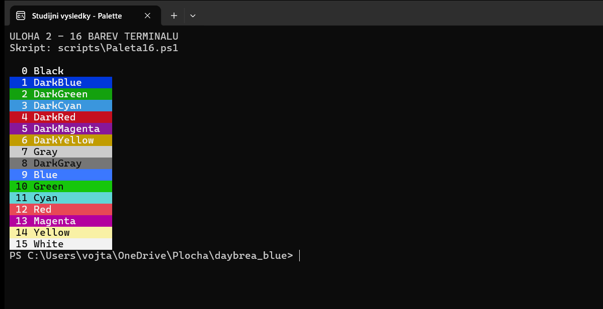

# Úloha 2 – paleta 16 barev terminálu

**Datum provedení:** 10. 11. 2026 
**Umístění reportu:** `odevzdani/Uloha-2-Paleta.md` 
Příkaz jsem spouštěl z kořene repozitáře. Snímek a záznam výstupu jsou odkázané relativně k tomuto reportu.

### Postup krok za krokem

1. Otevřel jsem PowerShell v kořeni repozitáře, aby odtud fungovala cesta ke skriptu.
2. Spustil jsem [Paleta16.ps1](../scripts/Paleta16.ps1):

   ~~~powershell
   pwsh -NoProfile -File .\scripts\Paleta16.ps1
   ~~~

3. Ve skriptu jsem prošel hodnoty `System.ConsoleColor` od 0 do 15 a každou zobrazil jako očíslovaný barevný pruh. Barvu textu jsem volil podle pozadí, aby byly popisky čitelné.

### Výsledek a snímek

Výstup obsahuje `Black`, `DarkBlue`, `DarkGreen`, `DarkCyan`, `DarkRed`, `DarkMagenta`, `DarkYellow`, `Gray`, `DarkGray`, `Blue`, `Green`, `Cyan`, `Red`, `Magenta`, `Yellow` a `White`. [Textový záznam](../evidence/powershell/02-paleta.txt) uchovává čísla a názvy; odstíny ukazuje skutečný snímek terminálu. Použil jsem pořadí `ConsoleColor`, protože jde o šestnáct přednastavených konzolových barev. Jejich konkrétní odstín určuje nastavení terminálu.

