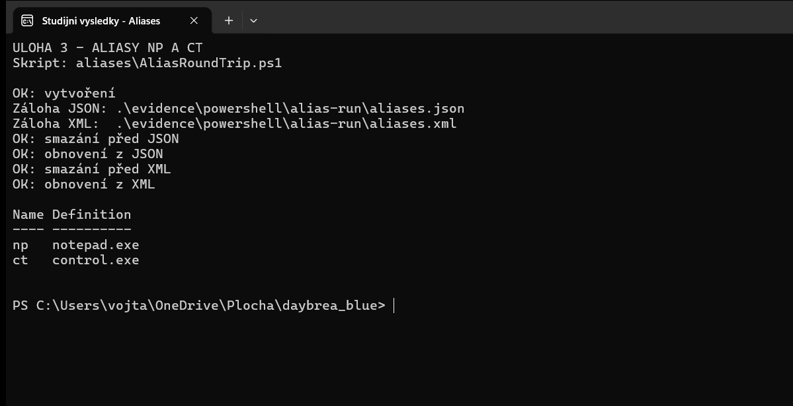

# Úloha 3 – aliasy `np` a `ct`, záloha a obnova z JSON/XML

**Datum provedení:** 10. 11. 2026 
**Umístění reportu:** `odevzdani/Uloha-3-Aliasy.md` 
Příkaz jsem spouštěl z kořene repozitáře. Použil jsem samostatný proces PowerShellu, aby aliasy po ukončení běhu nezůstaly v mé běžné relaci.

### Postup krok za krokem

1. Spustil jsem [AliasRoundTrip.ps1](../aliases/AliasRoundTrip.ps1) v samostatném procesu:

   ~~~powershell
   pwsh -NoProfile -File .\aliases\AliasRoundTrip.ps1
   ~~~

2. Pomocí `Set-Alias` jsem vytvořil `np → notepad.exe` a `ct → control.exe`.
3. Jejich definice jsem načetl přes `Get-Alias` a zálohoval do [aliases.json](../aliases/aliases.json) pomocí `ConvertTo-Json` a do [aliases.xml](../aliases/aliases.xml) pomocí `Export-Clixml`. Oba formáty jsem uložil, abych mohl vyzkoušet dvě nezávislé cesty obnovy.
4. Oba aliasy jsem smazal přes `Remove-Item Alias:...` a ověřil jejich nepřítomnost.
5. JSON jsem načetl přes `ConvertFrom-Json`, obnovil oba aliasy a ověřil jejich definice.
6. Aliasy jsem znovu smazal, XML načetl přes `Import-Clixml`, oba obnovil a opět ověřil.

### Výsledek a snímek

V [protokolu opakovaného běhu](../evidence/powershell/03-aliasy.txt) je pět úspěšných kontrol: `vytvoření`, `smazání před JSON`, `obnovení z JSON`, `smazání před XML`, `obnovení z XML`. Na konci procesu byly oba aliasy přítomné:

| Alias | Definice |
|---|---|
| `np` | `notepad.exe` |
| `ct` | `control.exe` |

Snímek jsem pořídil při opakovaném běhu, který uložil zálohy do `evidence\powershell\alias-run`. Hlavní zálohy jsou ve složce `aliases`. Skript jsem ověřil ve Windows PowerShellu 5.1 i v PowerShellu 7; oba běhy skončily úspěšně.
