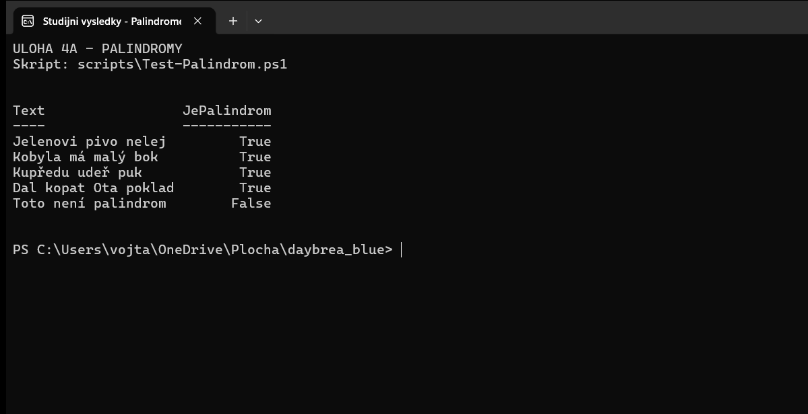
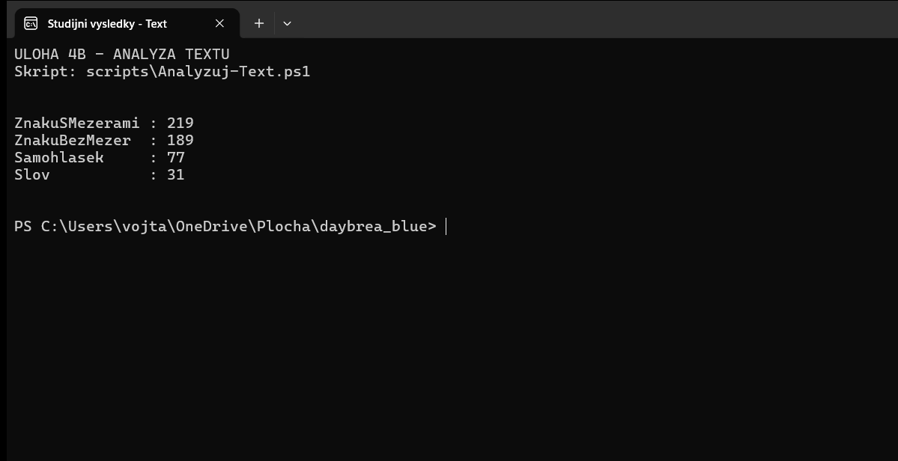

# Úloha 4 – palindrom a statistika zadaného textu

**Datum provedení:** 10. 11. 2026 
**Umístění reportu:** `odevzdani/Uloha-4-Text.md` 
Příkazy jsem spouštěl z kořene repozitáře. Oba programy jen zpracovávají předaný text a vypisují výsledek.

### 4A. Ověření palindromu

1. Napsal jsem [Test-Palindrom.ps1](../scripts/Test-Palindrom.ps1) a text mu předal jako argument, například:

   ~~~powershell
   pwsh -NoProfile -File .\scripts\Test-Palindrom.ps1 'Jelenovi pivo nelej'
   ~~~

2. Před porovnáním jsem sjednotil velikost písmen a odstranil diakritiku, mezery a interpunkci. Tím jsem mohl porovnat obsah věty bez vlivu jejího zápisu; normalizovaný řetězec jsem obrátil a porovnal s původním tvarem.

| Testovaný text | Výsledek |
|---|---|
| Jelenovi pivo nelej | `True` |
| Kobyla má malý bok | `True` |
| Kupředu udeř puk | `True` |
| Dal kopat Ota poklad | `True` |
| Toto není palindrom | `False` |

[Textový výstup všech pěti testů](../evidence/powershell/04-palindromy.txt):

### 4B. Počet znaků, samohlásek a slov

1. Do [Analyzuj-Text.ps1](../scripts/Analyzuj-Text.ps1) jsem předal celý text jako jeden argument v uvozovkách:

   ~~~powershell
   pwsh -NoProfile -File .\scripts\Analyzuj-Text.ps1 'Lewis Powell působil jako právník specializující se na tabákový průmysl ve společnosti Philip Morris. Byl pověřen, aby pro Americkou obchodní komoru vypracoval důvěrný dokument s cílem obnovit a rozšířit vliv korporací.'
   ~~~

2. Počet znaků jsem získal z délky řetězce včetně mezer a interpunkce. Pro druhý údaj jsem odstranil všechny bílé znaky. Samohlásky jsem počítal z množiny `aáeéěiíoóuúůyý` bez ohledu na velikost písmen a slova rozdělil podle bílých znaků.

| Metrika | Výsledek |
|---|---:|
| Znaky s mezerami | **219** |
| Znaky bez mezer | **189** |
| Samohlásky | **77** |
| Slova | **31** |

[Textový výstup analýzy](../evidence/powershell/04-text.txt). PowerShell `.Length` zde měří jednotky UTF-16; zadaný text neobsahuje znaky, u nichž by se tento rozdíl projevil.

