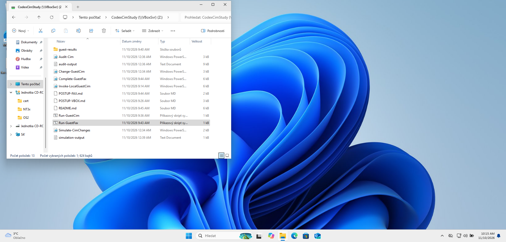
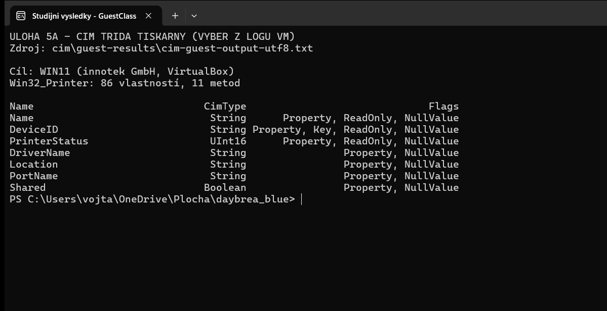
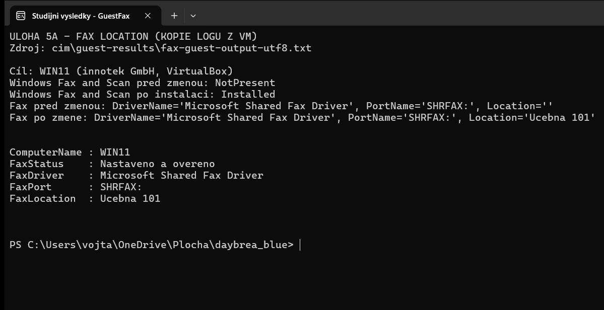
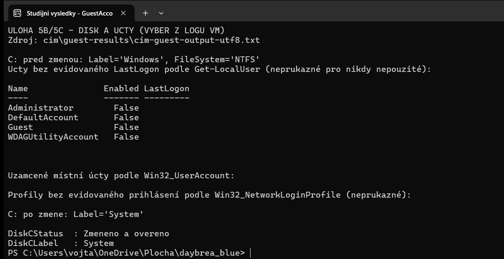

# Úloha 5 – Tiskárna, disk a místní účty přes CIM

**Datum:** 10. 11. 2026 
**Soubory v repozitáři:** `cim/` a `evidence/cim/` 
**Prostředí:** Windows 11 ve VirtualBox VM `win11`.

Změny štítku disku a umístění faxu jsem provedl ve VM, protože jsem potřeboval ověřit skutečný zápis přes CIM bez změny nastavení svého počítače. Na hostiteli jsem pouze četl stav pro srovnání.

### Prostředí a pořadí kroků

1. Nainstaloval jsem do VM Guest Additions 7.2.2, abych mohl předat skripty a zkopírovat výsledky zpět přes sdílené složky VirtualBoxu. Soubory skriptů a výstupů jsou v repozitáři ve složce `cim/`.
2. Jako správce jsem ve VM spustil [Run-GuestCim.cmd](../cim/Run-GuestCim.cmd), který volá [Invoke-LocalGuestCim.ps1](../cim/Invoke-LocalGuestCim.ps1). Skript ověřuje název `win11` a identitu VirtualBoxu, aby se změna neprovedla na jiném Windows. Vypsal třídu tiskáren a místní účty a změnil štítek `C:`.
3. Při prvním běhu jsem zjistil, že ve VM chybí fronta `Fax`. Spustil jsem proto jako správce [Run-GuestFax.cmd](../cim/Run-GuestFax.cmd), který volá [Complete-GuestFax.ps1](../cim/Complete-GuestFax.ps1). Funkce Windows Fax and Scan se doinstalovala a skript nastavil `Fax.Location` přes CIM. Běh skončil kódem `0`.
4. Původní výstupy jsem uložil na plochu účtu `student` ve VM jako `cim-guest-output.txt` a `fax-guest-output.txt`. Kopie jsou v repozitáři jako [protokol disku a účtů](../cim/guest-results/cim-guest-output-utf8.txt) a [protokol faxu](../cim/guest-results/fax-guest-output-utf8.txt).

Na snímku přímo z VM je sdílená složka a spouštěč; výsledné hodnoty dokládají protokoly níže.

### 5.1 Třída tiskáren a umístění faxu

Pomocí `Get-CimClass -ClassName Win32_Printer` jsem nejdříve zjistil, které vlastnosti mohu číst a které měnit. Ve VM má třída **86 vlastností a 11 metod**. Sledoval jsem zejména `Name`, `DeviceID`, `DriverName`, `PortName`, `Location`, `Shared` a `PrinterStatus`. `Location` nemá příznak `ReadOnly`, takže ji lze zapsat.

Při první kontrole nebyla ve VM žádná tisková fronta. Funkce Windows Fax and Scan měla stav `NotPresent`, proto jsem ji doinstaloval. Po přechodu do stavu `Installed` skript našel frontu `Fax` s ovladačem `Microsoft Shared Fax Driver` a portem `SHRFAX:`. Její původně prázdnou `Location` jsem přes `Set-CimInstance` nastavil na **`Učebna 101`**. Znovunačtení přes `Get-CimInstance` potvrdilo zadanou hodnotu; výstup uvádí `FaxStatus = Nastaveno a overeno` a spouštěč skončil kódem `0`.

V textovém logu je `Ucebna 101`: konzolové kódování při ukládání nahradilo `č` písmenem `c`. Skript předal `Učebna 101` a znovu načtenou hodnotu s tímto přesným řetězcem porovnal. Samotný log neukazuje spuštění `Add-Printer`; frontu jsem našel už po instalaci funkce.

### 5.2 Štítek disku `C:`

Pomocí `Get-CimInstance Win32_Volume` jsem u svazku `C:` zjistil NTFS a původní štítek **`Windows`**. Protože měl být štítek `System`, skript jej nastavil přes `Set-CimInstance` a znovu načetl. Výsledkem je **`DiskCLabel = System`** a `DiskCStatus = Změněno a ověřeno`. Můj hostitelský disk zůstal beze změny; audit pouze zjistil jeho štítek `Windows`.

### 5.3 Účty bez evidovaného přihlášení a uzamčené účty

Pomocí `Get-LocalUser` jsem ve VM vypsal účty s prázdným `LastLogon`. Našel jsem čtyři vypnuté účty:

| Účet | Enabled | LastLogon |
|---|---:|---|
| Administrator | False | prázdné |
| DefaultAccount | False | prázdné |
| Guest | False | prázdné |
| WDAGUtilityAccount | False | prázdné |

Pro srovnání jsem přes `Get-CimInstance Win32_UserAccount` hledal uzamčené účty: **žádný místní účet neměl `Lockout = True`**. Filtr nad `Win32_NetworkLoginProfile` pro prázdné `LastLogon` a nulový `NumberOfLogons` nevrátil žádný profil. Výpis je na snímku disku a účtů výše a v [úplném protokolu](../cim/guest-results/cim-guest-output-utf8.txt).

| Přístup | Co umožňuje zjistit | Omezení |
|---|---|---|
| `Get-LocalUser` | Místní účty a `LastLogon` | Nemá přímou vlastnost `Lockout`; prázdný `LastLogon` neprokazuje, že účet nebyl nikdy použit. |
| CIM `Win32_NetworkLoginProfile` | Profily, `LastLogon` a `NumberOfLogons` | Neposkytuje úplný historický důkaz pro každý místní účet. |
| CIM `Win32_UserAccount` | Místní účty a `Lockout` | Neobsahuje `LastLogon`. |

Prázdné `LastLogon` mi neumožňuje prokázat, že se ke čtyřem účtům **nikdo nikdy nepřihlásil**. Uvádím proto přesný výsledek jako seznam účtů *bez evidovaného LastLogon*, nikoli jako jistý seznam nikdy nepoužitých účtů.

### Příkazy, které jsem použil pro kontrolu

~~~powershell
Get-CimClass -ClassName Win32_Printer
Get-CimInstance -ClassName Win32_Printer
Get-CimInstance -ClassName Win32_Volume -Filter "DriveLetter='C:'"
Get-LocalUser | Where-Object { $null -eq $_.LastLogon }
Get-CimInstance -ClassName Win32_UserAccount -Filter 'LocalAccount=True' |
    Where-Object { $_.Lockout }
Get-CimInstance -ClassName Win32_NetworkLoginProfile |
    Where-Object { $null -eq $_.LastLogon -and $_.NumberOfLogons -eq 0 }
~~~

Zápis `Set-CimInstance` je ve výše uvedených skriptech. Před spuštěním zápisu jsem ověřoval identitu VM a oprávnění správce, aby se změna týkala jen `win11`.

## Zdroje

- [Microsoft – Win32_Printer](https://learn.microsoft.com/en-us/windows/win32/cimwin32prov/win32-printer)
- [Microsoft – Win32_Volume](https://learn.microsoft.com/en-us/previous-versions/windows/desktop/legacy/aa394515%28v%3Dvs.85%29)
- [Microsoft – Win32_UserAccount](https://learn.microsoft.com/en-us/windows/win32/cimwin32prov/win32-useraccount)
- [Microsoft – Win32_NetworkLoginProfile](https://learn.microsoft.com/en-us/windows/win32/cimwin32prov/win32-networkloginprofile)
- [Microsoft – Windows Fax and Scan capability](https://learn.microsoft.com/en-us/windows-hardware/manufacture/desktop/features-on-demand-non-language-fod?view=windows-11)
